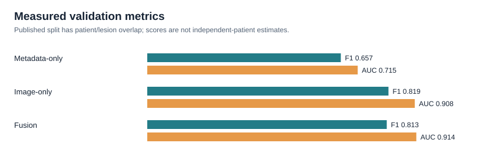

# Measured baseline results

Source: the student's saved Colab `metrics.json` and `run.json` in `results/baselines/`. This is **our published-manifest validation** experiment, not Ahammed et al.'s separate ISIC 2020 Kaggle test.

| Model | Macro-F1 | Balanced accuracy | ROC-AUC | Melanoma recall | Training minutes | Peak allocated GPU MB |
|---|---:|---:|---:|---:|---:|---:|
| Metadata-only | 0.6572 | 0.6580 | 0.7145 | 0.6106 | 0.24 | 17.2 |
| Image-only | 0.8190 | 0.8191 | 0.9085 | 0.8022 | 96.31 | 602.0 |
| Fusion | 0.8133 | 0.8140 | 0.9135 | 0.7533 | 95.52 | 808.6 |

**Figure 2.** Macro-F1 and ROC-AUC of the three completed baseline runs on the authors' validation split. Values were generated from saved JSON files. Group overlap prevents a patient-independent interpretation.

## Matched image versus fusion comparison

- Fusion minus image-only macro-F1: -0.0057; balanced accuracy: -0.0051; ROC-AUC: +0.0051.
- Image-only confusion matrix: [[820, 161], [194, 787]]; fusion: [[858, 123], [242, 739]]. Rows are true class 0/1, columns predicted 0/1. Fusion has +48 more false negatives and -38 fewer false positives at the fixed 0.5 threshold.
- The opposite directions for thresholded macro-F1 and ranking ROC-AUC suggest that the current decision threshold may affect the comparison. We do not retune the threshold on this validation set and then report the tuned score as an unbiased test result.

## Protocol and limits

All three runs used seed 42, 8 epochs, batch size 32, learning rate 1e-4, and NVIDIA L4. Their embedded training-source SHA-256 was `05b186ebf3c28d47307fb553ad44c6e1af5affb7d5e3513e7bdf96c943be0946`. The fixed final epoch was reported. The authors' manifests contain shared patient and lesion IDs across train/validation; single-run scores do not establish independent-patient generalization. GPU memory is PyTorch peak allocated memory, not total device occupancy.

Paper scores must be shown separately: Ahammed et al.'s Table 5 reports transfer EfficientNet-B3 image AUC 0.8754 and image+metadata AUC 0.8851 on the distinct ISIC 2020 test protocol. Our backbone, training budget, split, and reporting rule differ.

