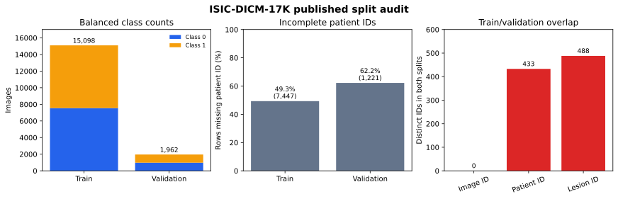

# ISIC-DICM-17K data audit

Status: initial Colab inspection, 2026-11-16. Counts below were produced by the student in Colab from the official ISIC-DICM-17K bundle and the authors' published train/validation CSV files, then pasted into the project chat. The files and full execution log have not yet been archived in this repository. No model was trained.

## Bundle inventory

| Check | Observed |
|---|---:|
| Extracted JPG images | 17,060 |
| `metadata.csv` rows | 17,060 |
| `metadata.csv` columns | 28 |
| Unique `isic_id` values | 17,060 |
| Duplicate `isic_id` values | 0 |
| Missing `patient_id` in bundle CSV | 8,668 |
| Missing `lesion_id` in bundle CSV | 4,519 |

The bundle CSV has no `benign_malignant` field. Its `diagnosis_1` distribution is 9,056 Malignant, 7,465 Benign, 534 Indeterminate, and 5 missing; it is **not** the paper's binary class label. Use the authors' manifest `class` field to define the paper's task.

## Published manifests

Sources: [train-set-metadata.csv](https://github.com/mmu-dermatology-research/isic-dicm-17k/blob/main/train-set-metadata.csv) and [valid-set-metadata.csv](https://github.com/mmu-dermatology-research/isic-dicm-17k/blob/main/valid-set-metadata.csv).

| Check | Train | Validation |
|---|---:|---:|
| Rows | 15,098 | 1,962 |
| Class 1 | 7,549 | 981 |
| Class 0 | 7,549 | 981 |
| IDs absent from bundle CSV | 0 | 0 |
| Missing `patient_id` | 7,447 | 1,221 |

Across train and validation, `isic_id` overlap is 0, but **433 nonmissing patient IDs** and **488 nonmissing lesion IDs** appear on both sides. These are counts of distinct overlapping identifiers, not counts of affected rows. They indicate group overlap and a substantial risk of optimistic validation performance. They do not by themselves establish whether exact duplicate image files appear across splits.

**Figure 1.** Published split audit. The first panel shows image counts by the authors' `class` label; the second shows missing `patient_id` values; the third counts distinct identifiers present in both splits. Overlap counts are **identifiers**, not affected image counts. Source values: student-run Colab audit, recorded in [`results/data_audit_counts.json`](../results/data_audit_counts.json). Regenerate with `python scripts/plot_data_audit.py`.

## Protocol decision

1. Use the authors' manifest split for a clearly labeled **paper-protocol baseline** and document the group overlap. Keep published scores separate from measured scores. The paper's separate ISIC 2020 Kaggle test remains unreplicated unless its protocol can be accessed.
2. Run a separate **leakage-controlled internal experiment** on cases with usable group identifiers. Freeze this split before tuning models. Cases lacking identifiers cannot be claimed patient independent. Check both patient and lesion overlap after splitting, and inspect near-duplicate images when possible.
3. Compare image-only, metadata-only, and fusion models under identical settings within each protocol. Keep the test set untouched until model selection is complete.

Next evidence needed: full Colab audit output saved as a text/JSON artifact, image filename matching, diagnosis-to-author-label cross-tabulation, and a reproducible group-controlled split manifest. Do not commit raw patient metadata or full split manifests publicly without reviewing their contents and licensing.

