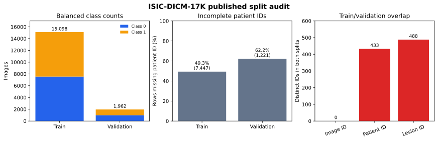
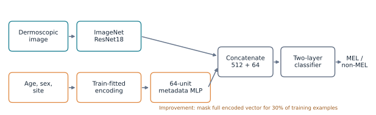
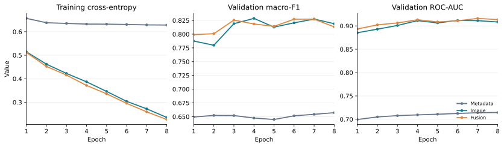
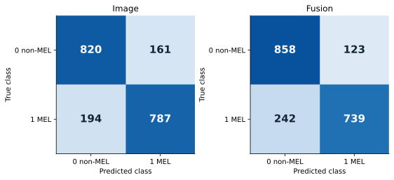
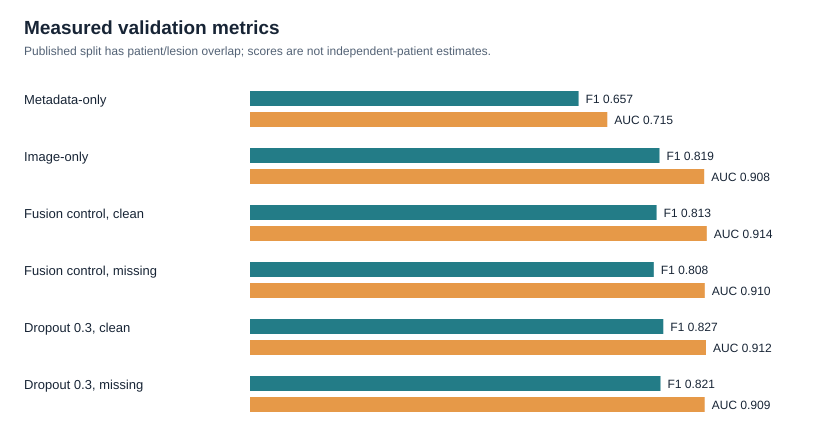

# Multimodal Skin Lesion Classification: A Reduced Reproduction and Missing-Metadata Robustness Study

Ibrahim Emin Ipek · YZM5110 Multimodal Learning Research Project · 17 November 2026

Repository: https://github.com/i-Emin/Multimodal-Skin-Cancer-Detection

**Completed experiment (17 November 2026).** All measurements below were read from saved Colab artifacts after the fixed eighth epoch.

## Abstract

This study tests clinical metadata in binary melanoma classification from dermoscopic images and a pre-specified missing-metadata training intervention. We audit ISIC-DICM-17K, train metadata-only, image-only, and late-fusion baselines, and compare standard fusion with training that masks clinical features for 30% of examples. Fusion yields higher ROC-AUC than image-only (0.9135 versus 0.9085), but lower macro-F1 (0.8133 versus 0.8190). Metadata dropout improves macro-F1 over standard fusion by 0.0133 both with metadata present and fully masked; the improvement is not specific to missing inputs. The published split shares patient and lesion identifiers across training and validation, so these single-seed scores do not establish new-patient performance.

## 1. Research question and source study

Ahammed et al. [1] curate ISIC-DICM-17K and investigate dermoscopic images combined with age, sex, and anatomical location. The specific published comparison is the transfer-learning EfficientNet-B3 row in their Table 5: image-only AUC **0.8754** and image+metadata AUC **0.8851** on the **10,982-image ISIC 2020 Kaggle test**. The predicted direction is a positive image+metadata difference; a zero or negative within-implementation difference would question whether this benefit transfers to our reduced setup. These published scores are **not directly comparable** to our 1,962-image validation scores. The paper's Table 5 also shows that adding metadata did not help every transfer-learning backbone, which tempers a universal-benefit claim. Our ResNet18 implementation is a reduced-backbone, partial reproduction of the comparison, not an exact reproduction of the paper's external-test score.

| Published experiment [1] | Image-only ROC-AUC | Image + metadata ROC-AUC | Evaluation set |
|---|---:|---:|---|
| Transfer EfficientNet-B3 | 0.8754 | 0.8851 | ISIC 2020 Kaggle test, 10,982 images |

**Table 1.** Authors' reported result. It is kept separate from our validation measurements in Section 7.

## 2. Literature synthesis

**Search and selection.** We began with the selected CVPRW paper and its official dataset repository, then searched PubMed/PMC, publisher pages, and citation/DOI links for skin-lesion image+metadata models, fusion comparisons, dataset provenance, and missing-feature ablations. We retained six papers spanning the source study, prior aggregation, competing fusion mechanisms, feature ablation, data construction, and historical multi-image fusion. We checked titles, years, and claims against primary full texts where available. This is a focused narrative selection, not a systematic review.

The six-paper comparison matrix is in [literature_matrix.md](literature_matrix.md). Ahammed et al. [1] provide the direct dataset and image/metadata comparison. Pacheco and Krohling [2] motivate clinical-feature aggregation, but their smartphone images differ from our dermoscopy setting. Das et al. [3] compare simple and attention-based fusion on HAM10000, motivating a concatenation baseline before adding complexity; the prose and preprocessing figure describe different split proportions, so its protocol needs caution. Sonuç et al. [4] emphasize clinical-feature ablations in a seven-class task; its scores cannot be transferred to our binary task. Pacheco et al.'s PAD-UFES-20 data paper [5] documents a different capture domain. Yap et al. [6] provide a useful counterexample: adding metadata to their two-image model lowered melanoma AUC from 0.866 to 0.861, although multiclass mAP rose slightly. Different labels, devices, and splits prevent direct comparison of numerical scores across these studies.

## 3. Technical concept and data audit

The official bundle contains 17,060 JPEG images and a 17,060-row, 28-column metadata table. The authors' manifests assign 15,098 training and 1,962 validation samples, balanced within each split. Every manifest ID matches the bundle table, and no image ID occurs in both splits. However, 433 distinct nonmissing patient IDs and 488 lesion IDs occur in both splits; 7,447 training and 1,221 validation rows lack patient IDs. These are overlapping *identifier* counts, not affected-row counts. The archive `diagnosis_1` field is not used as the binary target; we use the authors' `class` field. The full audit is in [data_audit.md](data_audit.md).

**Figure 1.** Class balance, missing patient identifiers, and distinct cross-split identifier overlap; the latter counts identifiers, not rows.

## 4. Reproduction implementation and deviations

**Technical mechanism.** The image branch maps a dermoscopic image to a 512-dimensional ResNet18 feature vector. The metadata branch median-imputes and standardizes age, one-hot encodes sex and general anatomical site using training-only statistics, then maps that vector through a 64-unit ReLU layer. Fusion concatenates the two representations and applies a two-layer classification head to produce two logits. Cross-entropy trains all parameters; AdamW updates them. Metadata-only and image-only models remove the other modality. This is late feature fusion, unlike attention methods that model pairwise interactions before classification.

**Figure 2.** Implemented two-branch model; the orange masking intervention is used only in the improved training run.

**Protocol.** The baselines use the same published manifests, seed 42, eight epochs, batch size 32, and learning rate 1e-4. Image and fusion use ImageNet-pretrained ResNet18. Training images are resized/cropped/flipped; validation uses resize and center crop at 224 pixels with ImageNet normalization. The original paper used 100 epochs, a cosine schedule with warm-up, Adam for EfficientNet/ResNet, early stopping, and best-epoch test reporting; our fixed-final-epoch, eight-epoch AdamW run is a deliberate compute reduction. The training code, source digest, history, predictions, settings, and metrics are saved as described in [REPRODUCE.md](../REPRODUCE.md). The student's L4 GPU is the training device. Wall time and peak allocated GPU memory are taken from saved run artifacts.

## 5. Improvement hypothesis and controlled comparison

After interim fusion epoch metrics were visible, but before the completed fixed-final-epoch result or any improved-model outcome, we fixed one intervention: mask the entire encoded metadata vector to zero for 30% of training examples. The matched p=0 fusion baseline is the control. Both models are evaluated on clean validation data and with all validation metadata masked. The primary outcome is the difference in macro-F1 under missing metadata; clean-input macro-F1 is the cost check. Balanced accuracy, ROC-AUC, confusion matrices, training time, and peak GPU memory are secondary observations. The fixed plan is in [improvement_hypothesis.md](improvement_hypothesis.md).

## 6. Experimental design and measures

The three modality baselines use the same training and validation manifests. We compare them at the fixed eighth epoch without selecting the best validation score. Accuracy is the fraction of correct binary decisions at threshold 0.5; balanced accuracy averages sensitivity over the two classes; macro-F1 averages their F1 scores; ROC-AUC measures ranking across thresholds. The confusion matrix uses rows for true labels and columns for predictions. Because melanoma is class 1, false negatives (row 1, column 0) deserve separate attention. GPU time is the measured Colab wall time, while peak GPU memory is PyTorch's maximum allocated memory, not total device use.

The improvement changes one training input rule and retains the split, backbone, seed, epoch count, optimizer, learning rate, and batch size. The existing p=0 fusion checkpoint is the control. Both checkpoints are evaluated on the same images with clean metadata and with the encoded metadata set entirely to zero. We report the predefined missing-input macro-F1 difference and the clean-input cost, with other metrics and resource use as supporting evidence. This artificial missingness test does not estimate clinical missingness frequency. A single seed and the group-overlapping validation split limit uncertainty and external validity.

## 7. Results

| Model / condition | Accuracy | Balanced accuracy | Macro-F1 | ROC-AUC | Time | Peak GPU memory |
|---|---:|---:|---:|---:|---:|---:|
| Metadata-only, clean | 0.6580 | 0.6580 | 0.6572 | 0.7145 | 0.24 min | 17.2 MB |
| Image-only, clean | 0.8191 | 0.8191 | 0.8190 | 0.9085 | 96.31 min | 602.0 MB |
| Fusion control, clean | 0.8140 | 0.8140 | 0.8133 | 0.9135 | 95.52 min | 808.6 MB |
| Fusion control, missing metadata | 0.8084 | 0.8084 | 0.8076 | 0.9096 | same training run | same training run |
| Fusion dropout 0.3, clean | 0.8267 | 0.8267 | 0.8266 | 0.9120 | 93.68 min | 600.7 MB |
| Fusion dropout 0.3, missing metadata | 0.8211 | 0.8211 | 0.8210 | 0.9094 | same training run | same training run |

The baseline rows above were read from the student's saved `metrics.json` and `run.json`, not transcribed from screenshots. All report the fixed eighth epoch on 1,962 validation examples. Fusion minus image-only macro-F1 is **-0.0057**, while ROC-AUC is **+0.0051**. At threshold 0.5, fusion has 48 more melanoma false negatives and 38 fewer non-melanoma false positives than image-only. The paired [error analysis](baseline_error_analysis.md) shows that fusion corrects 46 of the image model's melanoma errors but introduces 94 new ones. A higher ranking AUC thus does not imply an improved operating-point F1 or melanoma recall. Exact confusion matrices are in [baseline_results.md](baseline_results.md). This is one seed on a group-overlapping split; no independent-patient effect is claimed.

**Figure 3.** Training loss and validation macro-F1 and ROC-AUC from the saved epoch histories; the fixed eighth epoch is reported.

**Figure 4.** Final-epoch confusion matrices. Rows show true class and columns predicted class; melanoma is class 1.

**Figure 5.** Validation macro-F1 and ROC-AUC for all six measured conditions. The four fusion conditions use identical validation images and differ only by model training or metadata masking.

**Pre-specified comparison.** Dropout 0.3 minus control macro-F1 is **+0.01334** with all metadata masked and **+0.01333** with metadata present. The clean-to-missing macro-F1 drop is 0.00564 for control and 0.00563 for dropout; their difference is approximately 0.00001. Thus the primary missing-input comparison is positive, but the data do not show an additional robustness gain beyond the general clean-input improvement. Clean ROC-AUC is slightly lower with dropout (0.9120 versus 0.9135). The improved model trained for 93.68 minutes with 600.7 MB peak allocated GPU memory, compared with 95.52 minutes and 808.6 MB for the control. These resource differences are observations from separate Colab runs, not a controlled hardware benchmark.

**Operating-point errors.** Under clean metadata, dropout reduces melanoma false negatives from 242 to 193 while increasing non-melanoma false positives from 123 to 147. Under missing metadata, the corresponding counts are 248 to 201 and 128 to 150. A paired analysis of the saved prediction files finds that, on clean inputs, dropout corrects 113 control errors but creates 88 new errors; for melanoma alone it corrects 82 and creates 33. Under missing metadata it corrects 120 and creates 95 errors, including 91 corrected and 44 new melanoma errors. Masking metadata changes correctness for 83 of 1,962 control predictions and 51 of 1,962 dropout predictions, although both models lose 11 net correct classifications. These paired counts are descriptive; the single seed and overlapping patient/lesion groups prevent a robust clinical claim. Full aggregate tables and matrices are in [measured_results.md](generated/measured_results.md) and [paired error analysis](improvement_error_analysis.md).

## 8. Limitations, conclusions, and unresolved questions

The authors' validation split has patient and lesion overlap. Missing group IDs prevent a complete patient-independent check on all examples. A higher validation score therefore cannot establish performance on new patients. The reduced backbone and training recipe differ from the selected paper, while its separate test set is not evaluated. A single seed and a single split do not quantify variability. Manifest bytes were not hashed during training, so the exact data revision remains uncertain (see [data provenance](../data/provenance.md)). The missing-metadata experiment measures resilience to a defined artificial absence condition, not the full range of real clinical missingness. No clinical deployment claim follows from these results.

The measured baseline suggests that metadata can raise ranking AUC while worsening fixed-threshold macro-F1 and melanoma recall in this implementation. Metadata dropout improves both clean and missing-input macro-F1 but does not materially change the clean-to-missing degradation; it shifts the operating point toward fewer melanoma misses at the cost of more false alarms. A future study should freeze patient/lesion-group splits before model selection, repeat multiple seeds, test across acquisition sites, and evaluate calibration and clinically chosen operating thresholds.

**Reproducibility and AI-use disclosure.** The public repository linked on page 1 contains code, Colab notebooks, data-access instructions, saved aggregate results, and figure-generation scripts. Exact source SHA-256 and hardware settings are in each `run.json`; large checkpoints and per-image predictions stay in the student's Drive. Codex assisted with source discovery, coding, visualization, and report editing. The student ran the Colab experiments and remains responsible for citation checks, interpretation, and defending the work.

## References

1. S. Ahammed, X. Cui, W. Lu, and M. H. Yap, “Skin lesion classification using dermoscopic images and clinical metadata: Insights from multimodal models,” *Proceedings of the IEEE/CVF Conference on Computer Vision and Pattern Recognition Workshops*, pp. 222–230, 2025. [Open-access paper](https://openaccess.thecvf.com/content/CVPR2025W/MULA2025/papers/Ahammed_Skin_Lesion_Classification_Using_Dermoscopic_Images_and_Clinical_Metadata_Insights_CVPRW_2025_paper.pdf).
2. A. G. C. Pacheco and R. A. Krohling, “The impact of patient clinical information on automated skin cancer detection,” *Computers in Biology and Medicine*, vol. 116, article 103545, 2020. [doi:10.1016/j.compbiomed.2019.103545](https://doi.org/10.1016/j.compbiomed.2019.103545).
3. A. Das, V. Agarwal, and N. P. Shetty, “Comparative analysis of multimodal architectures for effective skin lesion detection using clinical and image data,” *Frontiers in Artificial Intelligence*, vol. 8, article 1608837, 2025. [doi:10.3389/frai.2025.1608837](https://doi.org/10.3389/frai.2025.1608837).
4. E. Sonuç, Q. Saihood, Y. Yargı Baydilli, and E. Özcan, “Interpretable multimodal fusion for skin lesion classification using dermoscopic images and patient metadata,” *Frontiers in Medicine*, vol. 13, article 1871689, 2026. [doi:10.3389/fmed.2026.1871689](https://doi.org/10.3389/fmed.2026.1871689).
5. A. G. C. Pacheco et al., “PAD-UFES-20: A skin lesion dataset composed of patient data and clinical images collected from smartphones,” *Data in Brief*, vol. 32, article 106221, 2020. [doi:10.1016/j.dib.2020.106221](https://doi.org/10.1016/j.dib.2020.106221).
6. J. Yap, W. Yolland, and P. Tschandl, “Multimodal skin lesion classification using deep learning,” *Experimental Dermatology*, vol. 27, no. 11, pp. 1261–1267, 2018. [doi:10.1111/exd.13777](https://doi.org/10.1111/exd.13777).

## Appendix A. Literature comparison matrix

Each record follows the seven fields required by the course brief. The linked [full matrix](literature_matrix.md) includes source links and open verification questions. Values are authors' reported findings unless explicitly labeled as our interpretation.

**[1] Ahammed et al. (2025).** Question/contribution: balanced ISIC-DICM-17K and the effect of clinical metadata. Modalities/assumptions: dermoscopy plus age, sex, and site, assumed available at inference. Mechanism/objective: image representations fused with encoded metadata for binary melanoma classification; the paper compares EfficientNet, ResNet-50, and MetaFormer. Data/protocol: 15,098 train, 1,962 validation; separate 10,982-image Kaggle test, 224-pixel preprocessing, up to 100 epochs. Baselines/evidence: transfer EfficientNet-B3 AUC 0.8754 image-only versus 0.8851 multimodal, but some other transfer backbones decline. Resources/reproducibility: dataset and manifests public; optimizer/schedule reported, GPU model not specified in the experimental section. Limitations/connections: our manifest audit detects patient/lesion overlap; external test cannot be reproduced here. [1]

**[2] Pacheco and Krohling (2020).** Question/contribution: whether patient clinical information improves smartphone-image classification. Modalities/assumptions: images plus age, region, symptoms and history, including potentially subjective answers. Mechanism/objective: CNN features concatenated with encoded clinical features, weighted cross-entropy, contribution-factor ablation. Data/protocol: six lesion categories and fivefold cross-validation; patient-group independence is not established in the cited protocol. Baselines/evidence: matched image-only and aggregated runs across six CNNs; authors report about seven percentage points average balanced-accuracy gain. Resources/reproducibility: PyTorch, Titan X/RTX 2080 Ti; code available on request. Limitations/connections: different device, labels, and richer metadata; supports simple fusion as a control rather than a transferable score. [2]

**[3] Das et al. (2025).** Question/contribution: compare fusion mechanisms on HAM10000. Modalities/assumptions: dermoscopy and age/sex/site. Mechanism/objective: ResNet plus MLP, concatenation through cross-attention variants, cross-entropy. Data/protocol: text describes random 70/30 train/test, train-only balancing, 256-pixel images; the protocol figure depicts 70/15/15. Baselines/evidence: metadata-only 77% and image-only 92% accuracy; authors rank cross-attention highest. Resources/reproducibility: RTX 4060, Adam, 100 epochs, batch 64. Limitations/connections: split-unit and figure/text inconsistency complicate comparison; additional fusion complexity does not remove the need for protocol controls. [3]

**[4] Sonuç et al. (2026).** Question/contribution: interpretable seven-class fusion and metadata ablations. Modalities/assumptions: HAM10000 dermoscopy plus age, sex, site. Mechanism/objective: ViT 768-dimensional embedding plus 32-dimensional metadata branch, concatenated before classification; SMOTENC metadata balancing and an ensemble. Data/protocol: 70/15/15 lesion-ID split before balancing; original validation/test prevalence retained. Baselines/evidence: authors report 90.27% image-only versus 95.02% multimodal ViT accuracy, with location the strongest individual metadata field. Resources/reproducibility: full methods published; code/checkpoint availability requires verification. Limitations/connections: synthetic metadata is paired with same-class images, not authentic patient-level co-occurrence; task and label space differ from ours. [4]

**[5] Pacheco et al. (2020).** Question/contribution: PAD-UFES-20 dataset release. Modalities/assumptions: smartphone images and up to 21 patient features. Mechanism/objective: data collection and descriptive benchmark rather than a directly comparable fusion training objective. Data/protocol: 2,298 images from 1,641 lesions and 1,373 patients, six diagnostic classes; 58.4% of lesions biopsy proven. Baselines/evidence: value lies in paired data, identifiers and diagnosis provenance, not a matched image-plus-metadata gain. Resources/reproducibility: dataset and article DOI published. Limitations/connections: repeated patient/lesion images require group-aware splits; capture setting differs from dermoscopy. [5]

**[6] Yap et al. (2018).** Question/contribution: whether multiple image types and metadata improve classification. Modalities/assumptions: each of 2,917 cases has dermoscopic and macroscopic images plus metadata. Mechanism/objective: CNN embeddings and feature fusion for binary melanoma and five-class tasks. Data/protocol: held-out test with fivefold cross-validation. Baselines/evidence: dermoscopy+macroscopic AUC 0.866 versus single macroscopic 0.784; adding metadata to the two-image model lowers melanoma AUC to 0.861 while slightly increasing multiclass mAP. Resources/reproducibility: full text reports modality ablations and mean/SD; compute/code availability needs verification. Limitations/connections: improvements from a second image do not imply metadata improves every endpoint. [6]

